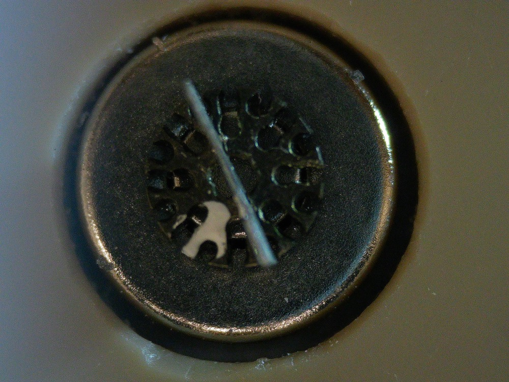

# Rotor angle tracking

The working doc for camera tracking of the rotor angle. Camera setup and scripts:
`README.md`. Status line: `../docs/STATUS.md` (angle tracking).

## Goal

From video, measure the rotor's **absolute angle** (full 360°), and from it the
**frequency, direction, and libration vs rotation**. Two uses:
1. **Confirm the frequency** for the spin-up stages (`../measurement_objective.md`), and
   settle the LES divisor (LES often reads 2× the true frequency; CLAUDE.md, LES).
2. Later, **feedback**: a live angle stream for a phase-locked drive.

**Not achieved yet.** The white mark has never been used to get a frequency.

## What the rotor looks like

`reference/rotor_mark_microscope.jpg` (microscope, top view). The rotor is the patterned
region in the middle (Snowflake V1.3, Ø3.5 mm, 0.75 mm thick, pyrolytic graphite; drawing
`../stator_flex/inputs/Snowflake_disk_V1.3_drawing.png`). The larger smooth disk around
it is not the rotor (Ø ≈ 6.4 mm by scale, probably the 1/4" magnet).
- **Arms:** 8 arms, each branching into 2 (16 tips at the edge), cut through the disk.
  The gaps between them are the dark "holes" in the photo. 8-fold symmetric, so a
  tracker that keys on them is ambiguous every 45°. (The drawing's "equally spaced 30°"
  note is wrong for this design; the DXF has no 12-fold content.)
- **Sail:** the bright straight bar across the centre, held in a 0.05 mm slot through the
  middle. Edge-on to the camera, it turns with the rotor and looks the same every 180°.
  In the Basler video it is the bright central blob on the rotation axis.
- **White mark:** an **irregular blob** of white paint filling gaps between arms,
  off-centre, about 60° from the sail, centre at r ≈ 1.05 mm (≈ 1.1 mm from the 29.8 px
  orbit in the 2026-10-28 Basler recording). It is the only feature that is unique in
  angle (no 180° ambiguity).

**In the Basler video it looks grey, not white** (Molly: it is clearly white by eye and
under the microscope). At ~0.09× the mark is only ~10–15 px, so blur, the old MJPG
compression and an exposure set by the bright board all wash it out. Lighting from the
side made it more identifiable (Molly, 2026-10-29). The paint's effect on balance has not
been measured.

## Current detector: `rotor_angle_loop.py`

The weighted centroid of the brightest `N_BRIGHT` pixels in the rotor region, then
atan2 about a rotation centre fitted over the first `--calib-s` seconds. Threshold-free
on purpose (a threshold detector dropped frames when the mark dimmed and silently
switched to another bright feature). A bad frame shows up as a radial outlier
(`--max-resid`).

Results, 2026-10-28 (`../apparatus_log.md`):
- **83% good detections on a recording, 31% live**, same code. Unexplained; not the
  search box.
- Sustains 50 fps at 0.78 ms/frame.
- A 3× harmonic carries 25% of the orbit's radial variance. No candidate cause.

Known risk: the brightest pixels in the rotor can be the sail or a glint rather than the
mark, which then gives a plausible but wrong angle.

## Lessons (read before writing a tracker)

- **Per-frame noise is the wrong quality metric.** A tracker can be smooth and wrong.
  Validate with loop-closure (de-rotate frames by the tracked angle; the rotor should
  sharpen), agreement between independent methods, and hand-labelled frames.
- **Use an absolute angle per frame**, not an accumulated one: differential trackers turn
  libration into fake rotation.
- **Symmetry aliases** (sail every 180°, holes every 45°); only the mark breaks it.
- **Fixed lab-frame features** (glints, lighting gradients) contaminate tracking. Check a
  candidate feature actually rotates.
- **Shadows of the sail** were the main failure in earlier sail-angle work.
- The motion is not purely in-plane (tilt, whirl); the orbit of the mark is not a perfect
  circle.

## Open (the tracking project)

To be scoped as a multi-agent project (`../CLAUDE.md`, Delegation):
- **Ground truth:** hand-label the mark angle on a few hundred frames from one recording;
  score every detector against it.
- **Detector:** find the mark reliably; reject sail/glint frames.
- **Angle → frequency:** unwrap, frequency and direction, libration vs rotation; compare
  with LES on the same recording.
- **Capture:** lossless recordings with per-frame timestamps are in place
  (`grab_basler.py`, 2026-10-28). More magnification would help most.
- **Live:** why 31% live vs 83% recorded.

## History: the old rotor (July 2026)

The earlier rotor had ~12 teeth and a thin dark diametric line. `darkline_tracker.py`
tracked that line (inner radial band 0.12–0.45 R, continuity gating) on the uEye clip
`output_roi_gps1468161639.avi`: −4.3 rev during spin-up, agreeing with an independent
m = 12 teeth method (−4.1 rev). The bright bar in that clip was a fixed glint. That code
does not apply to the current rotor, which has no dark line.
